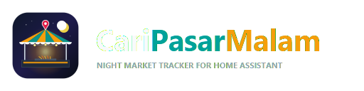

[](https://github.com/zubir2k/homeassistant-caripasarmalam/stargazers)
[](https://github.com/hacs/integration)
[](https://github.com/zubir2k/homeassistant-caripasarmalam/releases/)
[](https://github.com/zubir2k/homeassistant-caripasarmalam/actions/workflows/hassfest.yml)
[](https://github.com/zubir2k/homeassistant-caripasarmalam/actions/workflows/validate.yml)
[](PRIVACY.md)
[](LICENSE)
[](https://zubirco.de/buymecoffee)

A Home Assistant custom integration that brings **[Cari Pasar Malam](https://pasarmalam.app)** night market directories and schedules directly into your smart home.

> [!NOTE]
> **Privacy First**: This integration operates on a **100% Local-First** architecture. Your home and family members' GPS coordinates **never leave your Home Assistant server**. Read our full [Privacy Policy](PRIVACY.md).

Find which pasar malam is open tonight near your home or wherever your family members are across Malaysia, complete with opening times, operating status, live distance, amenities, and calendar schedules.

---

## ✨ Features

* 🏠 **Home Zone Proximity**: Defaults to your `zone.home` location with a customizable radius (default 10 km).
* 👤 **Live Person Tracking**: Automatically discovers `person.*` entities with GPS coordinates and calculates the nearest pasar malam to wherever each person is right now.
* 🗺️ **Bundled Interactive Lovelace Map Card (`caripasarmalam-card`)**: Built-in Leaflet map card with target switcher tabs (Home and family members), interactive market list with countdowns, and multi-platform turn-by-turn navigation (Google Maps, Waze, Apple Maps).
* ⚡ **Local In-Memory Spatial Matching**: Caches the entire Malaysian pasar malam directory (~1,139 markets) in Home Assistant's `.storage` once a day. All distance and schedule calculations run locally in Python without hammering the API.
* 📅 **Native Calendar Platform (`calendar`)**:
  * `calendar.pasarmalam_<target>`: Displays recurring weekly pasar malam schedules as native calendar events. Easily trigger automations 1 hour before the market opens!
* 🔔 **Sensors & Binary Sensors**:
  * `sensor.pasarmalam_<target>`: Number of markets currently open, with attributes for nearest open market, upcoming market, and full market details.
  * `binary_sensor.pasarmalam_<target>_open_tonight`: `on` if any pasar malam is scheduled today or currently open within radius.
  * `sensor.pasarmalam_dataset`: Diagnostic sensor tracking dataset sync timestamp and usable records.
* 🤖 **Action / Service (`caripasarmalam.get_nearby`)**:
  * Query markets on-demand around any person, zone, or GPS coordinates (`latitude`, `longitude`).
  * Returns structured response data for Automations, Voice Assist, and WhatsApp AI bots (**Pakbir AI**).
* 🇲🇾 **Pure Nationwide GPS**: Seamless tracking across all Malaysian states without manual state switching or boundary restrictions.
* 🌐 **Bilingual**: Full English and Bahasa Melayu support.

---

## 📦 Installation

### Option 1: Via HACS (Recommended)

[](https://my.home-assistant.io/redirect/hacs_repository/?owner=zubir2k&repository=homeassistant-caripasarmalam&category=integration)

> [!TIP]
> If you are unable to use the button above, manually add this repository:
> 1. Open **HACS** in your Home Assistant.
> 2. Click the three dots in the top-right corner and select **Custom repositories**.
> 3. Add `https://github.com/zubir2k/homeassistant-caripasarmalam` with category **Integration**.
> 4. Click **Download**, then restart Home Assistant.

### Option 2: Manual Installation

1. Copy the `custom_components/caripasarmalam` folder into your Home Assistant's `config/custom_components/` directory.
2. Restart Home Assistant.

---

## ⚙️ Configuration

1. In Home Assistant, go to **Settings** > **Devices & Services** > **Add Integration**.
2. Search for **Cari Pasar Malam**.
3. Set your preferred options:
   * **Radius**: Default `10` km.
   * **Markets listed per location**: Default `10`.

You can modify these options at any time by clicking **Configure** on the integration.

---

## 🗺️ Lovelace Map Card

A custom Lovelace card is bundled automatically with this integration.

Add it to any dashboard view:

```yaml
type: custom:caripasarmalam-card
entities:
  - sensor.pasarmalam_home
  - sensor.pasarmalam_zubir
map_height: 320       # px
list_limit: 6
show_closed: true
show_radius: true
dark_tiles: auto      # auto, true, false
language: auto        # auto, ms, en
```

- A tab per location; tap a market to fly to it on the map.
- Each row has **Map** (the market in Google Maps) and **Navigate**. The map popup has **Info** (the market's page on pasarmalam.app) and **Navigate**.
- **Navigate** opens the phone's own app chooser on Android (Google Maps, Waze, ...), a sheet with Apple Maps, Google Maps and Waze on iPhone/iPad, and Google Maps directions elsewhere.
- The button under the zoom controls re-centres on the selected person (or Home).
- Map tiles use OpenStreetMap with `strict-origin-when-cross-origin` referrer policy; dark mode is rendered seamlessly via CSS tile inversion matching Jejak Masjid (no external API keys required).

---

## 🛠️ Action / Service Usage

### `caripasarmalam.get_nearby`

Find pasar malam near any target with structured response data:

```yaml
action: caripasarmalam.get_nearby
data:
  entity_id: person.zubir
  radius: 10
  limit: 5
response_variable: nearby_markets
```

Or query by raw GPS coordinates:

```yaml
action: caripasarmalam.get_nearby
data:
  latitude: 3.0125
  longitude: 101.7852
  radius: 8
  limit: 3
response_variable: nearby_markets
```

Example response:

```json
{
  "count": 4,
  "open_count": 1,
  "today_count": 2,
  "radius_km": 10.0,
  "nearest": {
    "name": "Pasar Malam Taman Jasmin",
    "distance_km": 3.2,
    "status": "open",
    "address": "Jalan Jasmin 3, Taman Jasmin, 43000 Kajang, Selangor",
    "has_toilet": false,
    "has_prayer_room": false,
    "parking_available": false
  },
  "markets": [...]
}
```

---

## 💡 Example Automations

### 1. Alert at 4:30 PM if there is a Pasar Malam near Home tonight

```yaml
alias: "Pasar Malam Petang Ini Alert"
trigger:
  - platform: time
    at: "16:30:00"
condition:
  - condition: state
    entity_id: binary_sensor.pasarmalam_home_open_tonight
    state: "on"
action:
  - action: notify.notify
    data:
      title: "Jom Pergi Pasar Malam! 🍢"
      message: >-
        Ada pasar malam buka malam ini berdekatan rumah!
        Pasar malam terdekat: {{ state_attr('binary_sensor.pasarmalam_home_open_tonight', 'featured') }}.
```

### 2. Native Calendar Alert 1 Hour Before Pasar Malam Opens

```yaml
alias: "Pasar Malam 1 Jam Lagi Reminder"
trigger:
  - platform: calendar
    event: start
    offset: "-01:00:00"
    entity_id: calendar.pasarmalam_home
action:
  - action: notify.notify
    data:
      title: "Pasar Malam Buka 1 Jam Lagi! 🍢"
      message: "{{ trigger.calendar_event.summary }} bermula pada {{ trigger.calendar_event.start }}!"
```

---

## 🔒 Privacy, Security & Local-First Architecture

A common question when integrating location-aware sensors is: *"Does this integration share my home or family member locations with an external server?"*

**The short answer: No, never. Your location never leaves your Home Assistant instance.** For full details, see our [Privacy Policy](PRIVACY.md).

Here is exactly how your privacy and security are protected:

1. **Zero Outbound Location Queries**:
   - The integration **never sends your coordinates** (`latitude`, `longitude`), entity names, or home address to `pasarmalam.app` or any third-party server.
   - The only network request made is a **catalog download** fetching the public directory of Malaysian night markets (~1,150 records) at most once every 24 hours.
2. **100% Local Spatial Calculation**:
   - All distance calculations (Haversine great-circle formula between your targets and markets), radius filtering, and open/closing status resolution run **entirely in Python on your local Home Assistant hardware**.
3. **Database Recorder Protection**:
   - Large or frequent attribute changes (such as full market lists and real-time distance countdowns) are excluded from the Home Assistant database recorder (`_unrecorded_attributes`). This prevents database bloat and ensures no sensitive movement trails are stored.
4. **Private Map Tiles**:
   - The bundled Lovelace card renders OpenStreetMap tiles with `strict-origin-when-cross-origin` referrer policy. No private tokens, Home Assistant URLs, or personal identities are ever sent to map tile providers.

---

## 📜 Credits & License

* Data source: **[CariPasarMalam](https://pasarmalam.app)** by [@muazhazali](https://github.com/muazhazali/caripasarmalam).
* Licensed under the [MIT License](LICENSE).
